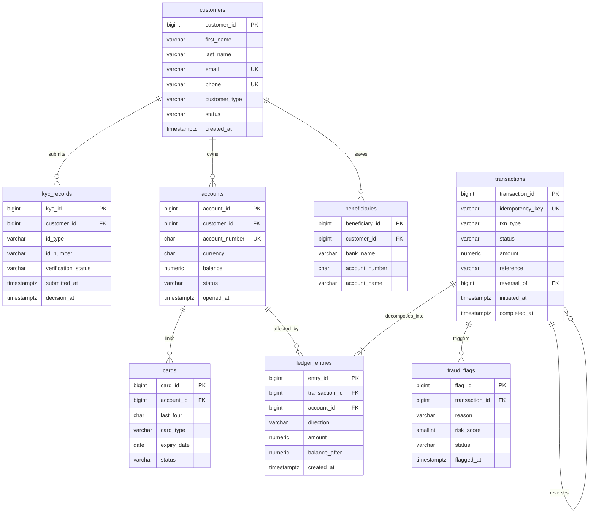

# Portfolio 1: Relational Database Design and Modelling – CedarPay

**Course:** Advanced Database Systems (MIT 8103)  
**Student Name:** Amarachukwu Chirim  
**Student ID:** 301914084  
**Case Study:** CedarPay Technologies Ltd. (Simulated Nigerian FinTech Platform)  
**Target RDBMS:** PostgreSQL 18 (pgAdmin 4)  
**Database Name:** `cedarpay_db`  

---

## 1. Overview & Objectives

Portfolio 1 establishes the relational foundation, normalized data models, and database-level integrity constraints for **CedarPay**, a simulated digital wallet and financial services platform based in Lagos, Nigeria. 

The primary objective of this portfolio is to design, implement, and validate an enterprise-grade relational schema in PostgreSQL 18 that:
1. Models the core operational and financial entities of a Nigerian FinTech platform within a sound relational architecture.
2. Supports Customer Due Diligence (CDD), tiered **KYC**, and Anti-Money Laundering (**AML**) auditability.
3. Implements an immutable **double-entry ledger** recording financial movements through balanced debit and credit entries ($\sum \text{Debits} = \sum \text{Credits}$).
4. Provides a documented **3NF** normalization structure, identifying four deliberate, controlled denormalization decisions optimized for OLTP read performance and audit snapshots.
5. Enforces strict engine-level constraints (`CHECK`, `UNIQUE`, `NOT NULL`, and `ON DELETE RESTRICT`) to prevent negative balances, duplicate transactions, and the accidental deletion of financial history.

---

## 2. Directory Structure & Documentation Map

This directory contains the complete specification, entity models, SQL scripts, and verification tests for Portfolio 1:

| File / Resource | Type | Description |
| :--- | :--- | :--- |
| [case-study.md](case-study.md) | Documentation | Comprehensive enterprise case study, regulatory context, actor personas, and workflow narratives. |
| [normalisation.md](normalisation.md) | Documentation | Detailed 3NF assessment by relation and formal justification for the 4 intentionally stored attributes. |
| [cedarpay.dbml](cedarpay.dbml) | Data Model | Database Markup Language (DBML) schema specification defining all 8 tables, fields, notes, and relationships. |
| [00_create_database.sql](00_create_database.sql) | SQL Script | Creates the `cedarpay_db` PostgreSQL database. |
| [01_verify_setup.sql](01_verify_setup.sql) | SQL Script | Verifies PostgreSQL version, current database connection, and authenticated user. |
| [02_create_tables.sql](02_create_tables.sql) | SQL Script | DDL script defining all 8 tables, constraints, foreign keys (`ON DELETE RESTRICT`), and lookup indexes. |
| [03_constraint_tests.sql](03_constraint_tests.sql) | SQL Script | Comprehensive automated test suite validating 15 database constraints within a rolled-back transaction. |
| [04_seed_data.sql](04_seed_data.sql) | SQL Script | Generates a realistic seed dataset (~5,001 customers, 6,001 accounts, ~200,000 transfers, ~400,000 ledger rows). |
| [Screenshots/](Screenshots/) | Evidence | Visual execution evidence inside pgAdmin 4 and environment setup captures. |

---

## 3. Data Architecture & Relational Entities

CedarPay's relational model is organized into five functional domains comprising eight core tables:

```
+--------------------------------------------------------------------------------+
|                                CEDARPAY DOMAINS                                |
+------------------------+------------------------+------------------------------+
| 1. Identity & KYC      | 2. Wallets & Accounts  | 3. Transactions & Ledger     |
|    - customers         |    - accounts          |    - transactions            |
|    - kyc_records       |                        |    - ledger_entries          |
+------------------------+------------------------+------------------------------+
| 4. Counterparties & Rails                       | 5. Audit, Risk & Compliance  |
|    - beneficiaries                              |    - fraud_flags             |
|    - cards                                      |                              |
+-------------------------------------------------+------------------------------+
```

### 3.1 Domain Breakdown & Table Specifications

1. **Identity & KYC**:
   - **`customers`**: Stores profile information, contact channels (`email`, `phone`), customer type (`INDIVIDUAL` or `MERCHANT`), and status (`ACTIVE`, `SUSPENDED`, `CLOSED`). Email and phone enforce strict uniqueness.
   - **`kyc_records`**: Records identity verification submissions (`NIN`, `BVN`, `PASSPORT`, `DRIVERS_LICENCE`). A customer may submit multiple records to support resubmission history. Enforces that `decision_at` is `NULL` while `PENDING` and populated once `VERIFIED` or `REJECTED`.

2. **Wallets & Accounts**:
   - **`accounts`**: Customer wallets denominated in `NGN`. Each account has a unique 10-digit account number (`CHECK (account_number ~ '^[0-9]{10}$')`). Enforces non-negative balances (`CHECK (balance >= 0)`). `balance` acts as an operational cached balance reconciled against the ledger.

3. **Transactions & Double-Entry Ledger**:
   - **`transactions`**: High-level business events (`DEPOSIT`, `WITHDRAWAL`, `TRANSFER`, `BILL_PAYMENT`, `REVERSAL`). Enforces client idempotency (`UNIQUE (idempotency_key)`), positive amounts (`CHECK (amount > 0)`), and reversal linkage constraints (`CHECK ((txn_type = 'REVERSAL') = (reversal_of IS NOT NULL))`).
   - **`ledger_entries`**: Immutable atomic debit and credit lines linked to transactions and accounts. Enforces direction (`DEBIT` or `CREDIT`), positive entry amounts, non-negative running balance snapshots (`CHECK (balance_after >= 0)`), and prevents duplicate directions per account within a transaction (`UNIQUE (transaction_id, account_id, direction)`).

4. **Counterparties & Payment Rails**:
   - **`beneficiaries`**: Saved counter-party transfer recipients. Enforces a 10-digit NUBAN-style account number format and composite uniqueness: `UNIQUE (customer_id, bank_name, account_number)`.
   - **`cards`**: Masked card credentials for top-ups. Implements PCI-DSS data minimization: stores only `last_four` (4 numeric digits), `card_type` (`DEBIT`, `VIRTUAL`), and `expiry_date`. Full PANs and CVVs are never stored.

5. **Audit, Risk & Compliance**:
   - **`fraud_flags`**: Suspicious activity alerts linked to transactions. Records a descriptive reason, workflow status (`OPEN`, `UNDER_REVIEW`, `CLEARED`, `CONFIRMED`), and risk score constrained to `CHECK (risk_score BETWEEN 0 AND 100)`.

---

## 4. Entity-Relationship (ER) Schema

The diagram below reflects the exact schema implemented in [02_create_tables.sql](02_create_tables.sql) and specified in [cedarpay.dbml](cedarpay.dbml):



---

## 5. Double-Entry Accounting Model & Ledger Balancing

### 5.1 Financial Invariants & Balanced Postings
CedarPay adheres to double-entry accounting principles: money cannot be created or destroyed arbitrarily. Every completed business transaction decomposes into balanced atomic debit (`DEBIT`) and credit (`CREDIT`) postings:

| Transaction Type | Debited Account (`DEBIT`) | Credited Account (`CREDIT`) | Invariant Rule |
| :--- | :--- | :--- | :--- |
| **Opening Deposit** | Central Settlement Account | Customer Wallet Account | $\text{DEBIT}(\text{Settlement}) = \text{CREDIT}(\text{Customer})$ |
| **P2P Transfer** | Sender Customer Account | Receiver Customer Account | $\text{DEBIT}(\text{Sender}) = \text{CREDIT}(\text{Receiver})$ |
| **Transaction Reversal** | Original Receiver Account | Original Sender Account | $\text{DEBIT}(\text{Receiver}) = \text{CREDIT}(\text{Sender})$ |

### 5.2 Multi-Row Balance Enforcement
Row-level `CHECK` constraints operate on individual rows and cannot compute aggregates across multiple rows. CedarPay ensures debit/credit parity through:
1. **Atomic Transaction Blocks**: Application and seeding operations execute within explicit `BEGIN ... COMMIT` blocks that insert both debit and credit entries atomically.
2. **Reconciliation Validation**: Database audits verify that every settled transaction balances to zero:
   ```sql
   SELECT transaction_id,
          SUM(CASE WHEN direction = 'DEBIT' THEN amount ELSE -amount END) AS net_imbalance
   FROM ledger_entries
   GROUP BY transaction_id
   HAVING SUM(CASE WHEN direction = 'DEBIT' THEN amount ELSE -amount END) <> 0;
   ```

---

## 6. Normalization Assessment & Deliberate Denormalization

As documented in [normalisation.md](normalisation.md), CedarPay’s schema adheres to **Third Normal Form (3NF)**:
- Each table represents a single logical subject.
- Primary keys identify records uniquely.
- Non-key attributes are fully functionally dependent on candidate keys with no transitive dependencies.

### 6.1 Controlled Denormalization Decisions
Four attributes are intentionally stored to optimize query performance, preserve historical context, and improve user experience:

| Attribute | Normalization Trade-Off | Operational Rationale | Required Safeguard |
| :--- | :--- | :--- | :--- |
| **`accounts.balance`** | Derivable from sum of ledger postings. | Avoids expensive $O(N)$ ledger aggregations on high-frequency balance checks and overdraft validation. | Atomic updates in the same transaction as ledger inserts; periodic reconciliation audits. |
| **`ledger_entries.balance_after`** | Derivable from ordered sequence of prior postings. | Provides a snapshot of the account balance at posting time for statement display and fast forensic review. | Generated exclusively by the posting engine; immutable once written. |
| **`transactions.amount`** | May duplicate the posting amount in simple transfers. | Represents the customer-agreed business transaction value for receipts, search, and dispute investigation. | Validation ensuring transaction amount aligns with corresponding ledger lines. |
| **`beneficiaries.account_name`** | May duplicate name registered at the destination bank. | Caches external bank name resolution so the user can see recipient details without repeating external API calls. | Treated as convenience metadata; re-verified when required by payment workflows. |

---

## 7. Constraint Testing & Integrity Verification

The schema's constraints are rigorously validated using [03_constraint_tests.sql](03_constraint_tests.sql). The suite tests both positive baseline assertions and negative failure conditions inside a self-contained transaction that is rolled back upon completion:

| Test ID | Constraint / Invariant Tested | Trigger Condition | Expected Result |
| :---: | :--- | :--- | :--- |
| **01** | Non-negative account balance | Insert account with `balance = -1` | Rejected (`check_violation`) |
| **02** | 10-digit account number format | Insert account with `account_number = '12AB'` | Rejected (`check_violation`) |
| **03** | Strictly positive transaction amount | Insert transaction with `amount = 0` | Rejected (`check_violation`) |
| **04** | Reversal transaction linkage | Insert `REVERSAL` without `reversal_of` FK | Rejected (`check_violation`) |
| **05** | Customer email uniqueness | Insert duplicate customer email | Rejected (`unique_violation`) |
| **06** | Idempotency key uniqueness | Insert duplicate `idempotency_key` | Rejected (`unique_violation`) |
| **07** | Account foreign-key referential integrity | Insert account referencing non-existent customer | Rejected (`foreign_key_violation`) |
| **08** | Deletion protection on active accounts | Delete customer with an active account | Blocked (`ON DELETE RESTRICT`) |
| **09** | Fraud risk score range (0–100) | Insert risk flag with `risk_score = 150` | Rejected (`check_violation`) |
| **10** | Duplicate ledger direction per transaction | Insert two `CREDIT` entries for same account | Rejected (`unique_violation`) |
| **11** | Allowed KYC verification status | Insert KYC record with `status = 'INVALID'` | Rejected (`check_violation`) |
| **12** | Completed transaction timestamp requirement | Insert `COMPLETED` transaction with `NULL` timestamp | Rejected (`check_violation`) |
| **13** | Allowed card type | Insert card with `card_type = 'INVALID'` | Rejected (`check_violation`) |
| **14** | Ledger entry foreign-key integrity | Insert ledger entry for non-existent account | Rejected (`foreign_key_violation`) |
| **15** | Beneficiary composite uniqueness | Insert duplicate `(customer_id, bank_name, account_number)` | Rejected (`unique_violation`) |

---

## 8. Implementation Roadmap & Execution Guide

### 8.1 Execution Order
To deploy and verify the Portfolio 1 database environment locally:

```bash
# Connect to PostgreSQL instance
psql -U postgres -h localhost

# 1. Initialize the CedarPay Database
\i portfolio-1-database-design/00_create_database.sql

# 2. Connect to the newly created database
\c cedarpay_db

# 3. Verify PostgreSQL environment & active user
\i portfolio-1-database-design/01_verify_setup.sql

# 4. Deploy schema tables, constraints, and indexes
\i portfolio-1-database-design/02_create_tables.sql

# 5. Run the 15-point constraint & integrity test suite
\i portfolio-1-database-design/03_constraint_tests.sql

# 6. Populate the synthetic FinTech dataset (~1 minute)
\i portfolio-1-database-design/04_seed_data.sql
```

---

## 9. Verification Evidence & Screenshots

All execution milestones and interface validations are documented in [Screenshots/](Screenshots/):

1. **Database Setup & Connectivity**:
   - [Screenshot 2026-10-20 at 00.22.02.png](Screenshots/Screenshot%202026-10-20%20at%2000.22.02.png): Confirms the successful creation of and connection to `cedarpay_db` inside pgAdmin 4 running on PostgreSQL 18.
2. **Initial Structure & Scope**:
   - [Screenshot 2026-10-19 at 23.46.50.png](Screenshots/Screenshot%202026-10-19%20at%2023.46.50.png): Captures initial repository configuration and portfolio structure.
3. *Additional screenshots capturing table creation in pgAdmin 4, test output notices, and row-count verifications after running `04_seed_data.sql` are stored in this directory.*

---

## 10. Alignment with Subsequent Portfolios

The schema established in Portfolio 1 directly provides the operational data foundation for subsequent portfolios:
- **Portfolio 2 (Query Optimization)**: Exploits the ~200,000 transfer records generated by [04_seed_data.sql](04_seed_data.sql) to analyze query execution plans (`EXPLAIN ANALYZE`), benchmark sequential scans versus index scans, and test partitioning strategies.
- **Portfolio 3 (Transactions & Concurrency)**: Evaluates row locking (`SELECT ... FOR UPDATE`), transaction isolation levels (`READ COMMITTED` vs `SERIALIZABLE`), and race condition prevention using the `accounts` and `ledger_entries` tables.
- **Portfolio 4 (NoSQL & Polyglot Persistence)**: Assesses Redis for low-latency balance caching and MongoDB for unstructured KYC document metadata.
- **Portfolio 5 (Distributed & Cloud Architecture)**: Evaluates replication, high availability, and failover architectures for `cedarpay_db`.
