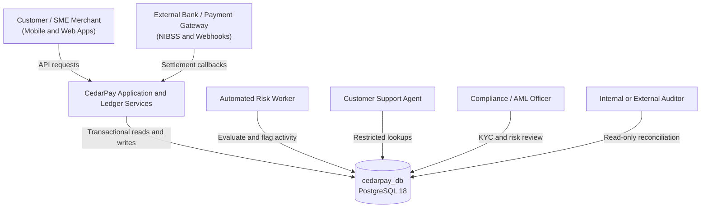

# Case Study: CedarPay (Simulated Nigerian FinTech Platform)
Course: MIT 8103 – Advanced Database Systems
Module: Portfolio 1 – Database Design and Modelling
Target System: cedarpay_db (PostgreSQL 18)
1. Executive Summary and Industry Context
1.1 The Nigerian FinTech Landscape
Nigeria's digital payments ecosystem supports mobile wallets, instant transfers, merchant payments, and bank-linked services. These systems must remain dependable despite network interruptions, delayed settlement notifications, and high transaction volumes. Database design is especially important when a payment request is retried, multiple transfers compete for the same funds, or a transaction needs to be investigated later.
CedarPay's simulated operating environment therefore focuses on:
- Network volatility and payment retries: External banking rails and payment APIs may time out or deliver callbacks more than once. The system needs idempotency and reconciliation controls to reduce duplicate processing.
- Concurrency and double-spending: Concurrent transfers must not spend the same available funds twice. Account updates and ledger postings must be coordinated within database transactions.
- KYC, AML and privacy: Customer identity checks, suspicious-activity review, and careful handling of personal information are important design considerations.
- Auditability: Financial activity should be traceable through durable transaction records and ledger entries. Corrections should be represented by compensating transactions rather than silently rewriting financial history.
1.2 Enterprise Profile: CedarPay Technologies Ltd.
CedarPay Technologies Ltd. is a simulated Nigerian financial technology platform based in Lagos. It provides digital wallets, peer-to-peer (P2P) transfers, merchant payment and collection services, and bank deposit and withdrawal workflows for individual customers and small-to-medium enterprises (SMEs).
CedarPay uses PostgreSQL as its relational system of record for customer information, wallet and account data, transaction records, double-entry ledger postings, and operational controls. The database name for this project is cedarpay_db. The wider portfolio explores complementary technologies such as Redis, MongoDB, and distributed database architecture in later phases; those capabilities should be described as implemented only when they have actually been built and tested.
2. Regulatory, Compliance, and Security Considerations
The schema is designed with Nigerian financial-services requirements and payment-data security principles in mind. The items below are design considerations for this simulated project, not a claim that the implementation is certified or legally compliant.
Standard / Consideration	Relevant context	Potential schema or implementation impact
Tiered KYC	Customer due diligence and identity verification	Store KYC submissions and their status transitions, such as PENDING, VERIFIED, and REJECTED. Support re-submission history where appropriate.
NUBAN-style account numbers	Nigerian bank account numbering conventions	Store account numbers as strings and validate the required 10-digit format where that rule applies to the simulated account type.
Payment-card data minimisation	PCI DSS principles	Do not store full card numbers, CVVs, or card PINs. Keep only permitted metadata such as last_four, card type, and expiry date, and use a token from a compliant provider where card processing is simulated.
Personal-data protection	Nigeria Data Protection Act and applicable guidance	Restrict access to personal data, define retention and deletion rules, and preserve required audit history.
AML / CFT monitoring	Suspicious-activity monitoring and investigation	Store risk flags with a score, reason, status, timestamps, and appropriate links to the related transaction or customer.

Actual compliance depends on operational processes, access controls, retention policies, security testing, and relevant legal review—not database constraints alone.
3. Database Users and Actor Personas
The cedarpay_db system supports several actors. In a production-style design, database privileges should follow least privilege, and customer-facing users should normally access data through application services rather than receive direct unrestricted database access.

3.1 Detailed User Profiles
1. Retail customers and SME merchants
   - Access mode: Mobile/web application mediated by CedarPay services.
   - Key operations: Check balances, transfer funds, pay merchants or bills, save beneficiaries, and view transaction history.
   - Workload: Frequent reads and atomic writes requiring consistent results.
2. Customer support and dispute agents
   - Access mode: Internal support portal.
   - Key operations: Look up customers, investigate payment status, and review disputes.
   - Workload and permissions: Mostly read-heavy. Direct modification of posted ledger entries should be prohibited.
3. Compliance, fraud and AML analysts
   - Access mode: Risk and compliance dashboard.
   - Key operations: Review KYC submissions, investigate fraud flags, and manage authorised risk workflows.
   - Workload: Filtered and time-range queries across customers, transactions, and risk scores.
4. Automated application and ledger services
   - Access mode: Dedicated application service accounts and connection pools.
   - Key operations: Process transfers, write balanced ledger entries, handle payment callbacks, and run reconciliation.
   - Workload: Transaction-heavy operations requiring atomic commits and appropriate concurrency control.
5. Financial auditors
   - Access mode: Read-only reporting or audit connection.
   - Key operations: Verify debit/credit equality and reconcile stored account balances against ledger history.
   - Workload: Historical scans and aggregations, preferably isolated from operational write permissions.
4. System Scope and Major Data Domains
CedarPay's relational model is organised into five functional domains. The exact tables and relationships must match the SQL schema implemented for Portfolio 1.
+--------------------------------------------------------------------------------+
|                                CEDARPAY DOMAINS                                |
+------------------------+------------------------+------------------------------+
| 1. Identity and KYC     | 2. Wallets and Accounts| 3. Transactions and Ledger   |
|    - users              |    - wallets/accounts  |    - transactions             |
|    - kyc_verifications  |    - wallet_types      |    - ledger_entries           |
|                         |    - currencies         |    - transaction_types        |
+------------------------+------------------------+------------------------------+
| 4. Counterparties and Payment Rails       | 5. Audit, Risk and Compliance       |
|    - beneficiaries                       |    - audit_logs                     |
|    - linked_bank_accounts                |    - fraud_risk_flags               |
|    - cards                               |                                     |
+------------------------------------------+-------------------------------------+
4.1 Identity and KYC
The identity domain stores customer profiles and KYC verification history. Depending on the final schema, entities may include users and kyc_verifications.
- Customer profiles include identifiers, name, contact details, account type, status, and timestamps.
- KYC records support multiple submissions or verification attempts where required.
- Sensitive identity values should not be exposed in plain-text logs. Hashing, encryption, key management, access restrictions, and retention policies must be selected according to the use case.
- KYC status constraints can prevent logically inconsistent records, such as a pending verification having a completed verification timestamp.
4.2 Wallets, Accounts, and Payment Instruments
The wallet/account domain stores customer-owned financial accounts, currency or wallet type information, and permitted payment instruments.
- Each account has a unique account identifier and an appropriate account number format.
- Account status may include values such as ACTIVE, FROZEN, or CLOSED.
- Monetary values use an exact numeric type such as NUMERIC(19,4), rather than floating-point types.
- If a balance is stored for fast operational reads, it is a controlled denormalisation and must be reconciled against the ledger.
- Card records should retain only the card metadata permitted by the chosen design; full PAN, CVV, and PIN data must not be stored.
4.3 Transactions and Double-Entry Ledger
The transaction domain separates a business event from the accounting entries that record its financial effect.
- transactions records events such as DEPOSIT, WITHDRAWAL, TRANSFER, BILL_PAYMENT, and REVERSAL, subject to the implemented type definitions.
- Each client-originated operation should carry a unique idempotency key or reference. A uniqueness constraint prevents key reuse; application/database transaction logic must also return or safely resolve the original outcome when a request is retried.
- ledger_entries records debit and credit lines linked to the transaction and the affected account or wallet.
- A posted financial transaction must contain at least two ledger entries and satisfy the applicable balancing rule: total debits equal total credits for the transaction and currency.
- Financial history should be append-only in the application design. Reversals should be recorded as new compensating transactions linked to the original transaction, rather than deleting or silently editing posted entries.
- If running balances are stored on ledger rows, the implementation must define their ordering and protect updates against concurrent writes.
4.4 Counterparties and Payment Rails
This domain may include saved beneficiaries, linked bank accounts, and card metadata. Beneficiary records are convenience data; financial transactions and ledger history require stronger retention and deletion controls. A beneficiary's account number should be stored as text, validated according to the project rules, and protected as personal or financial information.
4.5 Audit and Risk Controls
Audit and risk tables record relevant operational events and suspicious activity.
- Risk flags may include a reason, score constrained to a range such as 0–100, workflow status, timestamps, and references to the associated transaction or customer.
- Audit records should identify the actor, action, target, and event time where relevant.
- “Tamper-evident” or “immutable” should only be claimed if appropriate permissions, append-only controls, retention, and monitoring are implemented and tested.
5. Key Business Workflows
5.1 Peer-to-Peer Wallet Transfer
A simplified successful transfer follows this logical sequence:
1. Receive the request and idempotency key.
2. Check whether the key has already been processed; if so, return or resolve the original result rather than post the payment again.
3. Begin a database transaction.
4. Lock the relevant account rows in a consistent order, for example with SELECT ... FOR UPDATE, to reduce conflicting updates and deadlock risk.
5. Validate account status, currency compatibility, and sufficient available funds.
6. Create the transaction record.
7. Write the debit and credit ledger entries, plus any fee entries where applicable.
8. Update stored balances in the same database transaction if the design maintains them.
9. Validate the complete posting and commit. On failure, roll back all related changes.
The workflow is a design description; it should not be presented as implemented until supported by SQL code and test evidence.
5.2 Transaction Reversal
If a payment needs to be reversed:
1. Retain the original transaction and its ledger entries for traceability.
2. Create a new transaction of type REVERSAL and link it to the original transaction.
3. Post the appropriate compensating debit and credit entries.
4. Update the original transaction's status only if the status model permits this and the update is recorded consistently. Do not rewrite or delete the original ledger entries.
5. Reconcile the reversal and original transaction so the financial effect is explainable and auditable.
A row-level CHECK can enforce that reversal_of is present for a reversal and absent for other transaction types. Additional rules—such as preventing multiple reversals of the same transaction—need appropriate unique constraints and/or transactional logic.
6. Architectural Invariants and Database Constraints
Invariant / Rule	Possible SQL or processing mechanism	Purpose and limitation
Exact monetary values	NUMERIC(19,4) or a precision appropriate to the currency	Avoids floating-point representation errors. The selected scale must match the currencies and business rules being modelled.
Non-negative available balance	CHECK (available_balance >= 0) plus safe transactional balance updates	The check validates the stored row value; concurrency protection is still required to prevent competing transactions from overspending.
Balanced double-entry posting	Controlled posting function, carefully designed deferred constraint trigger, or another verified transaction-level mechanism	A normal row-level CHECK cannot sum multiple ledger rows. Validate complete postings before they are finalised.
Idempotency	UNIQUE (idempotency_key) plus safe retry handling	Uniqueness prevents duplicate key records, but retry code must return or resolve the prior result correctly.
Reversal linkage	CHECK ((txn_type = 'REVERSAL') = (reversal_of IS NOT NULL))	Requires a link for reversals and prohibits it for other transaction types; it does not alone prevent double reversals.
Account-number format	CHECK (account_number ~ '^[0-9]{10}$'), where appropriate	Ensures a stored account number contains exactly ten digits. Apply this only to account types for which the rule is valid.
Card data minimisation	CHECK (last_four ~ '^[0-9]{4}$') and omission of sensitive card fields	Validates the last-four field; the check alone does not establish PCI DSS compliance.
Financial history retention	Appropriate foreign-key deletion rules, privileges, and append-only controls	Prevents unintended deletion of historical financial records.
Beneficiary lifecycle	A deliberate foreign-key policy, possibly ON DELETE CASCADE for convenience records	Choose this only if deleting a customer is permitted and beneficiary records are safe to remove.
KYC state consistency	For example, CHECK (verified_at IS NULL OR verification_status <> 'PENDING')	Prevents a pending record from having a completed verification timestamp; it does not implement the full KYC workflow.

7. Mapping to the MIT 8103 Portfolio Roadmap
CedarPay is the shared simulated case study for the five portfolio areas. Each later phase should build on the schema and evidence actually produced in earlier phases.
- Portfolio 1 – Relational Design and Modelling: ER modelling, relational schema, keys and constraints, normalisation, database setup, and constraint testing.
- Portfolio 2 – Query Optimisation: Baseline query plans, EXPLAIN ANALYZE, index design, and performance comparison. Defer performance indexes where needed to preserve a meaningful baseline.
- Portfolio 3 – Transactions and Concurrency: ACID behaviour, isolation levels, row locking, race-condition testing, and deadlock handling.
- Portfolio 4 – NoSQL and Polyglot Persistence: Evaluate Redis and MongoDB for appropriate cache, document, or event-payload use cases; distinguish the proposed architecture from tested implementation.
- Portfolio 5 – Distributed and Cloud Architecture: Evaluate replication, partitioning, availability, failover, and recovery trade-offs. Do not claim zero data loss or a specific availability level without configuration and test evidence.
8. Scope and Evidence Note
This case study describes the intended CedarPay design. The actual table names, column names, database version, constraints, and implemented behaviour must be verified against the SQL scripts and execution evidence. Any unimplemented feature should be labelled as planned or proposed.
The final Portfolio 1 submission should include the case-study description, ER diagram, SQL schema, constraint tests, normalisation explanation, screenshots, and progressive Git commits. Any AI assistance should be declared according to the assessment instructions, including how generated suggestions were checked and adapted.